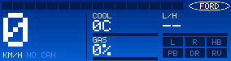
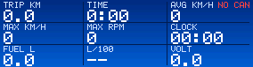

# Ford Fiesta MK5 — бортовий комп'ютер на ESP32-S3 + розбір CAN

Прошивка ESP-IDF для ESP32-S3 і дисплея ST7789P3 2.25" 76×284 (ландшафт 284×76): бортовий ПК (trip computer) для Ford
Fiesta MK5 (2008, 1.4 бензин), який **лише слухає** обидві CAN-шини авто й нічого не передає.

> **English:** an ESP-IDF firmware that turns a 76×284 ST7789 display into a trip computer for a 2008 Ford Fiesta MK5
> by passively listening to its MS-CAN (125 kbit/s, on-chip TWAI) and HS-CAN (500 kbit/s, MCP2515). The main value of the
> repo is [`docs/CAN-ANALYSIS.md`](docs/CAN-ANALYSIS.md): a documented reverse-engineering of the signals (rpm, speed,
> gas, coolant, doors, lock, brake, injector pulse width and an injected-fuel counter) with the raw dumps in
> [`dumps/`](dumps/) and the tools to reproduce it.





*(скріншоти без CAN-даних: авто вимкнене, тому `NO CAN`; зняті командою `F`)*

## Що в репозиторії

| Шлях | Що |
|---|---|
| [`docs/CAN-ANALYSIS.md`](docs/CAN-ANALYSIS.md) | **детальний розбір даних із CAN-шин**: сигнали, формули, докази, гіпотези |
| [`dumps/`](dumps/) | сирі дампи кадрів, з яких зроблено розбір |
| [`tools/`](tools/) | запис дампа, аналіз, керований тест педалей, скріншот екрана |
| `main/main.c` | уся прошивка (`app_main`) |
| `main/mcp2515.[ch]` | драйвер MCP2515 (HS-CAN, listen-only) |
| `main/car_icons.h` | 1-бітні іконки авто й дверей для попапа |
| `main/main.c.*` | старі версії прошивки (у збірку не входять) |

## Можливості

- **DRIVE:** шкала обертів, швидкість, температура, педаль газу, миттєва витрата (л/100 км або л/год), чипи L/R/HB/PB/DR/RV,
  попап дверей з іконками.
- **TRIP:** пробіг, час, середня й макс. швидкість, макс. обороти, годинник авто (6 параметрів, 3×2).
- **FUEL:** витрачено пального, середня витрата за поїздку, напруга (3 параметри, великим шрифтом).
- **MENU** (утримати кнопку 5 с): яскравість, крок круїзу, `AUTO LOCK` (лише зберігає вибір), `FUEL CAL`, `TANK L`,
  скидання поїздки, CAN-дамп.
- **Круїз — лише порадник:** ПІ-регулятор за швидкістю показує потрібне положення газу, нічого не приводить. Скасовується
  при гальмі, втраті даних, швидкості поза 15…130 км/год або падінні швидкості під уставку.
- **USB-команди:** `N` (екран), `D` (дамп кадрів), `S` (круїз), `F` (скріншот), `G` (читання As-Built GEM; єдиний випадок, коли прошивка передає на MS-CAN: лише запити читання, лише на нерухомому авто з ручником), `O`/`P` (макети попапа/круїзу), `+`/`-`.

## Залізо

| Вузол | Піни ESP32-S3 |
|---|---|
| Дисплей ST7789P3 (SPI) | SCL=12, SDA=11, RST=8, DC=9, CS=10, BL=7 (PWM, активний низький) |
| MS-CAN (TWAI + VP230) | RX=4, TX=5 (не використовується) |
| HS-CAN (MCP2515, 8 МГц) | SCK=14, MOSI=15, MISO=16, CS=17, INT=18 |
| Енкодер HW-040 | CLK=1, DT=2, SW=6 (разом з BOOT = GPIO0) |

Трансівери VP230 (SN65HVD230) працюють від 3,3 В, тож дільник для них не потрібен (раніше були TJA1050 на 5 В, усі дампи зняті вже з VP230). Трансівер на платі MCP2515 теж замінено, усе живиться від 3,3 В. Термінатори 120 Ом
на модулях вимкнути. OBD-II: HS-CAN піни 6/14, MS-CAN 3/11, земля 4/5.

## Збірка

ESP-IDF 6.0.x (проєкт зібрано на 6.0.2):

```sh
idf.py set-target esp32s3      # один раз
idf.py build
idf.py -p <порт> flash
```

Тестів і лінтера немає; перевірка візуальна на залізі. Діагностики clangd про `sys/features.h` тощо — шум (clangd
парсить хост-компілятором).

## Стан і обмеження

- Усе перевірено на **одній машині**; формули можуть відрізнятись на інших Fiesta.
- Підтверджено за панеллю авто: обороти, швидкість, газ, температура, поворотники, ручник, двері, дальнє, замок, гальмо, годинник.
- **Паливо** береться з лічильника впорскування `0x360` d7: шкала **не відкалібрована** (див. [§7 розбору](docs/CAN-ANALYSIS.md#7-як-знайдено-паливо)).
- `AUTO LOCK` лише зберігає вибір; запис в As-Built модуля GEM не реалізовано (потрібна передача на MS-CAN).
- Зчеплення на CAN **немає**; команди газу на CAN **немає** — привід круїзу не реалізовано свідомо.

## Безпека й відмова від відповідальності

Прошивка пасивна: TWAI і MCP2515 у listen-only, нічого не передається й не підтверджується. Єдиний виняток — ручна USB-команда `G`: на кілька секунд MS-CAN переходить у normal і передає лише запити читання (`10 87`, `21 01/02/03`) до GEM; без запису й скидання. Підключення до авто — на
власний ризик; помилка в підключенні OBD чи живленні може пошкодити електроніку. Нічого з цього не призначено для
керування автомобілем. Дані отримані на одній машині й подаються «як є», без гарантій.

## Подяки й джерела

Початкові ID/формули MS-CAN взято з [roncapat/Ford-Fiesta-MK5-MS-CAN-bus](https://github.com/roncapat/Ford-Fiesta-MK5-MS-CAN-bus);
усе, що позначено ✅/🟡 у розборі, перевірено на машині автора.

## Ліцензія

MIT, див. [`LICENSE`](LICENSE).
